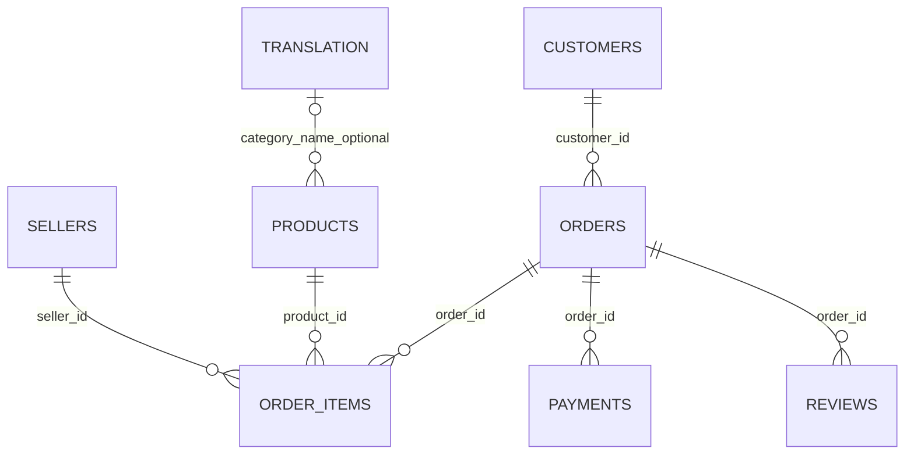

# Relational model and verified grain

Source: Olist official Kaggle version 2, CC BY-NC-SA 4.0. This diagram documents structure; derived tables/figures are for noncommercial review.

| Table | Observed rows | Grain and key |
|---|---:|---|
| Customers | 99,441 | Unique customer_id; customer_unique_id can repeat across order-level records |
| Orders | 99,441 | Unique order_id; foreign key to customer_id |
| Items | 112,650 | (order_id, order_item_id); product_id and seller_id foreign keys |
| Payments | 103,886 | (order_id, payment_sequential) |
| Reviews | 99,224 | (review_id, order_id) unique in this extract; review_id alone repeats 814 times |
| Products | 32,951 | Unique product_id; category optional |
| Sellers | 3,095 | Unique seller_id |
| Geolocation | 1,000,163 | ZIP prefix is not unique; no direct row-level join authorised |
| Category translation | 71 | Unique category name; optional match, not a total foreign-key guarantee |

The supplemental review verifies all listed primary keys and six source foreign-key relationships; none have orphan rows. There are 610 products without category and 13 with a non-null category absent from the translation lookup. Keep these records visible with an unknown/untranslated category rather than dropping them. ZIP prefixes remain strings, preserving leading zeroes. Review and outcome attributes are post-purchase descriptive information, not purchase-time predictors.

`../results/relational_review.json` is the machine-readable evidence. `../order_grain.sql` independently preaggregates each many-side table before joining to orders.
